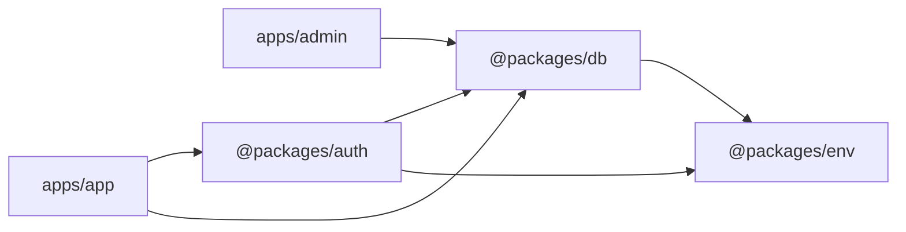

# システム構成

このリポジトリが**今**どう組まれているかの正本。構成が変わったら、その変更を入れる PR でここを書き換える。

- `apps/*` の中の置き場所・依存の向き・命名は [directory-structure.md](directory-structure.md) にある
- プロダクト全体の目的は [product.md](../product.md)、機能ごとの目的・要件・振る舞いは [prds/](../prds/README.md) にある。ここには、それをどう実現しているかを書く
- なぜこの構成になったかは [design-docs/](../design-docs/README.md) にある。ここには経緯を書かず、リンクだけ置く

**design doc はこの文書の代わりにならない。** design doc は書いた日の判断の記録で、実装後は凍結する。今使っている技術・構成・技術的な制約は、design doc にあっても、必ずここに書く。

## 全体像

pnpm workspace の monorepo で、タスクは Turborepo で回す。

```text
apps/
├─ app/          プロダクト側。TanStack Start。スタイルは StyleX で手書きする
└─ admin/        管理画面。TanStack Start。UI は Astryx のコンポーネントで組む
packages/
├─ db/           D1 の DB client、業務の schema、migration、seed
├─ auth/         Better Auth の設定、認証の schema、auth client
├─ env/          環境変数の schema と、検証済みの env
└─ tsconfig/     共有の tsconfig（今は packages/env だけが使う）
```

パッケージの依存は次の向きになっている（各 `package.json` の `dependencies`）。



`@packages/db` が `@packages/env` を使うのは、`drizzle.config.ts` が `ENABLE_AUTH` を読むときだけ。

**アプリどうしは参照しない。** `apps/app` と `apps/admin` の両方が欲しがるものが出たら `packages/` へ出す。

**管理画面は、`apps/app` の中に入口を足すのではなく、別のアプリ・別の Worker にしている。** 管理画面のコードをプロダクト側の利用者に配らないため（[prds/admin-console.md](../prds/admin-console.md) の業務ルール）と、片方のデプロイでもう片方が落ちないようにするため。経緯は [20260828_admin-app-astryx.md](../design-docs/20260828_admin-app-astryx.md) にある。

## 実行環境

| | `apps/app` | `apps/admin` |
| --- | --- | --- |
| フレームワーク | TanStack Start + TanStack Router | 同じ |
| ビルド | Vite | 同じ |
| 実行環境 | Cloudflare Workers | 同じ（別の Worker） |
| Worker の名前 | `web-app-template` | `web-app-template-admin` |
| dev の port | 3000 | 3001 |
| UI | StyleX で手書き | Astryx |

- どちらも `@cloudflare/vite-plugin` を通すので、**dev のときから workerd の上で動く**
- `wrangler.jsonc` は `main: "@tanstack/react-start/server-entry"`、`compatibility_flags: ["nodejs_compat"]`、`preview_urls: true`
- Worker の名前はテンプレートを使う人が自分のものに変える前提で、`wrangler.jsonc` に TODO コメントがある。2 つのアプリで名前を重ねない
- `pnpm dev` は 2 つのアプリを同時に立てる

## データベース

Cloudflare D1 を Drizzle ORM（`drizzle-orm/d1`）で使う。経緯は [20260906_db-turso-to-cloudflare-d1.md](../design-docs/20260906_db-turso-to-cloudflare-d1.md)。

### 接続

- `packages/db/src/client.ts` が `cloudflare:workers` の `env.DB`（D1 binding）を `drizzle()` に渡し、module 直下の `db` を export する。呼び出し側は `import { db } from '@packages/db'`
- **binding の名前は `DB` で固定。** `packages/db` が名前で引くので、両アプリの `wrangler.jsonc` で同じ名前にする
- **両アプリの `wrangler.jsonc` は同じ D1（`database_name` / `database_id`）を指す。** Cloudflare 上では 1 つのデータベースを共有する
- 接続情報は binding で渡すので、`.env` に DB の設定は無い

### workerd 専用

- **`@packages/db` は workerd の中でしか動かない。** `cloudflare:workers` は workerd の組み込みモジュールなので、Node で動く script や `*.config.ts` からは import できない。Node から schema が要るときは `packages/db/src/schema.ts` を直接指す（[directory-structure.md の依存の方向](directory-structure.md#依存の方向)）
- binding の型は `packages/db/src/cloudflare.d.ts` で最小限だけ宣言している。**`@packages/db` を使うアプリは、このファイルを `tsconfig.json` の `include` に足す。** `@cloudflare/workers-types` は使わない（`lib: ["DOM"]` と衝突する）
- `packages/db`・`packages/auth`・`packages/env` は自前の型検査を持たない。型が検査されるのは、アプリの `tsc --noEmit` がそれらを読み込むとき

### schema

| 定義 | テーブル | 用途 |
| --- | --- | --- |
| `packages/db/src/schema.ts` | `users` | 業務のデータ（[prds/users.md](../prds/users.md)） |
| `packages/auth/src/schema.ts` | `user`・`session`・`account`・`verification` | Better Auth が使う |

`users` と `user` は別のテーブル。`/login` で作ったアカウントは `user` に入り、ユーザー一覧が読む `users` には入らない。両者の関係は決まっていない（[prds/users.md の未確認事項](../prds/users.md#未確認事項)）。

### migration と seed

- SQL は `drizzle-kit generate`（`pnpm -F db generate`）で `packages/db/migrations/` に生成する。**migration の定義はここ 1 か所だけ**
- 生成の対象は `ENABLE_AUTH` で変わる。`true` なら `packages/db` と `packages/auth` の両方の schema、`false` なら `packages/db` だけ
- 適用は `wrangler d1 migrations apply` で、入口は各アプリの `db:migrate`。`wrangler.jsonc` の `migrations_dir` が `../../packages/db/migrations` を指す
- seed は `packages/db/seed.sql` を `wrangler d1 execute --file` で流す。入口は各アプリの `db:seed`
- **ローカルの D1 はアプリごとに分かれる。** state は各アプリの `.wrangler/state` にあり、`apps/admin` で入れたデータは `apps/app` からは見えない

コマンドは [runbooks/d1-migrations.md](../runbooks/d1-migrations.md)、新しい D1 の作り方は [runbooks/create-d1.md](../runbooks/create-d1.md)。

### 使えないもの

- **`db.transaction()` は使えない。** D1 は明示的な `BEGIN` / `COMMIT` を受け付けず、実行時に落ちる。複数の文をまとめたいときは `db.batch()` を使う。`@packages/auth` が使う better-auth の drizzle adapter は、`transaction` が既定で `false` なので影響しない

## 認証

Better Auth を `packages/auth` にまとめ、今は `apps/app` だけが使う。`apps/admin` は `@packages/auth` に依存していない。要件と振る舞いは [prds/auth.md](../prds/auth.md)。

| 何を | どこに | import |
| --- | --- | --- |
| サーバーの設定 | [packages/auth/src/lib/auth.ts](../../packages/auth/src/lib/auth.ts) | `import { auth } from '@packages/auth/auth'` |
| クライアント | [packages/auth/src/lib/auth-client.ts](../../packages/auth/src/lib/auth-client.ts) | `import { authClient } from '@packages/auth/auth-client'` |
| パスワードのハッシュ（scrypt） | [packages/auth/src/lib/password.ts](../../packages/auth/src/lib/password.ts) | `auth.ts` の中だけで使う |
| `/api/auth/*` の route | [apps/app/src/routes/api/auth/$.ts](../../apps/app/src/routes/api/auth/$.ts) | — |

- データは drizzle adapter（`provider: 'sqlite'`）で D1 に置く
- `better-auth/tanstack-start` の cookie plugin を使う
- `authClient` はクライアント SDK なので、画面から直接使ってよい（[directory-structure.md](directory-structure.md#packages-の扱い)）

### 有効・無効の切り替え

- `ENABLE_AUTH` が `true`（未設定も含む）なら `betterAuth()` を組み立てる。`false` なら、`auth` は `{ message: 'Authentication is disabled.', code: 'AUTH_DISABLED' }` を `404` で返すだけの `handler` を持つオブジェクトに置き換わる。この応答はクライアントから見える契約で、正本は [prds/auth.md の振る舞い](../prds/auth.md#振る舞い)
- 値の読み方は[環境変数](#環境変数)にある。migration の生成対象も `ENABLE_AUTH` で変わる（[migration と seed](#migration-と-seed)）

### base URL

`BETTER_AUTH_URL`、無ければ `APP_BASE_URL`、それも無ければ `http://localhost:3000` を使う（`auth.ts` の `getBaseUrl()`）。

### メールアドレスとパスワード

- `emailAndPassword.enabled: true`。ハッシュと照合は、better-auth の既定ではなく `password.ts` の scrypt（`node:crypto`）に差し替えている。保存する形は `<salt>:<hash>` の hex
- **パスワードの長さは指定していない。** better-auth の既定（`minPasswordLength` 8、`maxPasswordLength` 128）がサーバー側で効く。ログイン画面の入力欄も別に `minLength={8}` を持つ
- メールアドレスの確認（`requireEmailVerification`・`emailVerification`）は設定しておらず、`autoSignIn` も既定のまま。そこから出てくる振る舞い（作成の直後にログイン状態になる、登録済みのメールアドレスは `422` になる）は [prds/auth.md](../prds/auth.md#例外境界条件) にある

### OAuth

- 資格情報は provider ごとに `<PREFIX>_CLIENT_ID` と `<PREFIX>_CLIENT_SECRET`。`<PREFIX>` は provider の id を大文字にしたもの（`github` → `GITHUB`、`x` → `X`）
- 対応する provider と接頭辞の一覧の正本は、[packages/env/src/index.ts](../../packages/env/src/index.ts) の `SOCIAL_PROVIDER_ENV_PREFIXES`。env の schema もこの一覧から作る
- 2 つがそろった provider だけを `socialProviders` に入れる。1 つもそろわなければ `socialProviders` 自体を渡さない

### `/api/auth/*` の route

- `GET` と `POST` を `auth.handler` にそのまま渡す
- **失敗を記録する。** 応答が `ok` でないときは、メソッド・パス・ステータス・`cf-ray`・応答本文（JSON なら解析したもの）を `console.error` に出す。処理が例外で落ちたときは、メソッド・パス・`cf-ray`・例外（名前・メッセージ・stack）を出して、例外を投げ直す

## 環境変数

[packages/env/src/index.ts](../../packages/env/src/index.ts) の schema で検証する。検証には [T3 Env](https://env.t3.gg/) と [valibot](https://valibot.dev/) を使う。

**アプリのコードから `process.env` を直接読まない。** 検証済みの `env` を import する。

```ts
import { env } from '@packages/env'

env.ENABLE_AUTH // boolean
env.APP_BASE_URL // string | undefined
```

- 検証は `env` を最初に import した時点で走り、欠けている値と形式が不正な値をまとめて報告する
- **必須の値は無い。** `ENABLE_AUTH` は未設定なら `true` になり、それ以外はすべて任意
- 空文字は未設定として扱う
- `ENABLE_AUTH` は `1` / `true` / `yes` / `on` と `0` / `false` / `no` / `off` を受け付ける。それ以外の文字列はエラー
- **変数を増やすときは `.env.template` と schema の両方に足す。** schema に無いキーは `env` から読めない
- R2 の 5 つ（`R2_*`）は schema で存在を宣言しているだけで、今はコードから読まれていない

ブラウザに渡す値はこの package に置かない。`packages/env` は drizzle-kit からも読まれるため `process.env` だけを参照する。`VITE_` プレフィックスの値を使うときは、`import.meta.env` を `runtimeEnv` にした env を `apps/app` 側に別に定義する。

### 値の出どころ

| 場面 | どこから読むか |
| --- | --- |
| ローカル | `packages/env` が `dotenv/config` で、**コマンドを実行したディレクトリの `.env`** を読む。そのため各 package に、ルートの `.env` へのシンボリックリンクを置く（ルートの [README.md](../../README.md) のセットアップ） |
| Cloudflare Workers | `nodejs_compat` が secrets を `process.env` に流し込むので、ローカルと同じ書き方で読める |

**Workers の secrets は `apps/app` だけが持つ。** `apps/app/wrangler.jsonc` の `secrets.required` に `ENABLE_AUTH`・`APP_BASE_URL`・`BETTER_AUTH_URL`・`BETTER_AUTH_SECRET` が並び、`pnpm -F app cf:set-env`（`scripts/set-secrets.sh`）がこの 4 つを `apps/app/.env.production` から `wrangler versions secret put` で投入する。`apps/admin` は secrets を持たない。

## スタイリング

### `apps/app` — StyleX

経緯は [20260826_tailwind-to-stylex.md](../design-docs/20260826_tailwind-to-stylex.md)。

- スタイルは各ファイルの `stylex.create` に書く。`@stylexjs/stylex` は実行時にも残るので dependency、コンパイラの `@stylexjs/unplugin` は devDependency
- **トークンは色とフォントだけ。** `src/styles/tokens.stylex.ts` の `stylex.defineVars` にまとめる（`defineVars` は `.stylex.ts` のファイルにしか書けない）。余白や文字サイズはトークンにせず、各 `stylex.create` に直接書く
- `src/styles/globals.css` は最小限の reset と、`html` / `body` の土台だけ。**StyleX の出力は `globals.css` の要素セレクタより必ず強い**ので、個別の要素のスタイルは `globals.css` ではなく `stylex.create` に書く（`useCSSLayers` は既定の `false`）
- **配色は light 固定**（`color-scheme: light`）。ダークモードは無い
- `@/` エイリアスは `vite.config.ts` の `stylex.vite({ aliases })` にも書く。StyleX は `*.stylex.ts` の実体を tsconfig の `paths` を見ずに解決するため
- dev のときだけ、`__root.tsx` の head に StyleX の CSS と HMR 用の script を足す（`src/lib/stylex-dev-head.ts`）。TanStack Start は `index.html` を持たないので、プラグインの自動注入が効かない
- `@stylexjs/eslint-plugin` は使えない。linter が oxlint のため

### `apps/app` — アイコン

- アイコンは `reicon-react` から import し、**`@/lib/icon` の `Icon` を通して描く**（`<Icon icon={Home} />`）。`<Home />` と直接書くとライブラリ既定の太さ 1.5 で描かれる。このアプリの太さ 2 は `Icon` が渡している

### `apps/admin` — Astryx

経緯は [20260828_admin-app-astryx.md](../design-docs/20260828_admin-app-astryx.md)、使い方の正本は [apps/admin/README.md](../../apps/admin/README.md)。

- `@astryxdesign/core` のコンポーネントと `@astryxdesign/theme-neutral` のテーマを使う。Vite のプラグインは要らない
- `src/styles/globals.css` が Astryx の CSS を 3 枚、順番どおりに import する。`src/lib/astryx-provider.tsx` の `Theme` で包まないとトークンが効かない
- `Theme` の `mode` は既定の `system` のまま使う。配色は OS の設定に従って light / dark が切り替わる
- `LinkProvider` は使っていない。TanStack Router の `Link` と props が合わないため、リンクはフルリロードになる
- 画面固有の調整に備えて `@stylexjs/unplugin` を `apps/app` と同じ設定で入れている
- `components/ui/` は作らない。ドメインを知らない表示部品は Astryx が持っている

## 開発ツール

| 何を | 道具 | 設定 |
| --- | --- | --- |
| パッケージ管理 | pnpm（`packageManager` で版を固定、`saveExact: true`） | `pnpm-workspace.yaml` |
| タスク | Turborepo（`dev`・`lint`・`fmt`・`gen`） | `turbo.json` |
| 型検査 | `tsc --noEmit`（各アプリの `lint:tsc`） | 各アプリの `tsconfig.json` |
| lint | oxlint（各アプリの `lint:oxlint`） | `.oxlintrc.json` |
| 未使用の検出 | knip（ルートの `lint:knip`） | `knip.jsonc` |
| format | oxfmt | `.oxfmtrc.json` |
| Git フック | lefthook | `lefthook.yml` |
| 依存の更新 | Renovate | `renovate.json5` |

- `pnpm lint` は、各アプリの `tsc --noEmit` と `oxlint`、ルートの `knip` を流す
- **依存の向きは oxlint の `no-restricted-imports` で止めている。** 中身は [directory-structure.md の lint で強制している](directory-structure.md#lint-で強制している)
- lefthook の pre-commit がステージ済みの JS/TS に `oxlint --fix` と `oxfmt` をかけ、pre-push が `pnpm lint` を流す
- **公開から 7 日未満のバージョンは入れない。** `pnpm-workspace.yaml` の `minimumReleaseAge: 10080`（分）と `renovate.json5` の `minimumReleaseAge: "7 days"` を揃えている。例外の入れ方は [runbooks/minimum-release-age.md](../runbooks/minimum-release-age.md)
- テストを走らせる仕組み（テストランナーと script）は今は無い。置き場所の規約だけがある（[directory-structure.md のテストの置き場所](directory-structure.md#テストの置き場所)）

## デプロイ

- **`main` へのマージで自動でデプロイされる**（Workers Builds）
- **今 Cloudflare にあるのは `apps/app` の Worker（`web-app-template`）だけ。** 2026-11-15 に確かめたところ、`apps/admin` の Worker（`web-app-template-admin`）は無かった。`apps/admin/wrangler.jsonc` も `preview_urls: true` を持つので、デプロイすれば認証の無いまま外から届く（[prds/admin-console.md](../prds/admin-console.md)）
- secrets は事前に `pnpm -F app cf:set-env` で次のデプロイ向けに登録しておく。`wrangler versions secret put` なので、その場では本番に反映されない
- 新しい D1 はデプロイの前に `--location apac` を付けて手で作る（[runbooks/create-d1.md](../runbooks/create-d1.md)）。リモートの D1 に migration を当てていないと、デプロイが通っても画面がユーザーを引けずに落ちる（[runbooks/d1-migrations.md](../runbooks/d1-migrations.md)）

## 既知の食い違い

今の構成と文書・設定が合っていないところ。直す方針が決まったら、ここから消して本文に反映する。

- **DB を引くまとまりの置き場所。** [directory-structure.md](directory-structure.md#未決-db-を引くまとまりの置き場所) の規約は「使う画面が 1 つのうちは `screens/` の中」だが、lint は `screens/` からの `@packages/db` を止める。両アプリとも、画面 1 つでしか使わない `users` を `features/users/` に置いている
- **`apps/admin` の Astryx の版がそろっていない。** [apps/admin/README.md](../../apps/admin/README.md) は「version は 3 つとも揃える」と書いているが、今は `@astryxdesign/core` が `0.7.1`、`@astryxdesign/theme-neutral` が `0.5.0`（peer に `core` の `0.5.0` を取る）、`@astryxdesign/cli` が `0.7.0`
- **`apps/app/biome.json` が残っている。** 存在しない `@packages/biome-config/biome` を extends していて、linter は oxlint に移っている
- **`pnpm-workspace.yaml` の `allowBuilds` のコメント**が「このリポジトリは libsql しか使わない」のまま。今の driver は D1
- **R2 の設定。** ルートの README はセットアップで R2 のバケットと CORS を用意させ、Wrangler の節で `services.service` と `r2_buckets.bucket_name` を調整するよう書いているが、どちらの `wrangler.jsonc` にもその項目は無く、`R2_*` の env もコードから読まれていない
- **`minimumReleaseAgeExclude` の例外が残っている。** `vite@8.2.4`・`@tanstack/react-start@1.168.60`・`better-auth@1.7.7` は 2026-10 のセキュリティ更新で足したもので、[runbooks/minimum-release-age.md](../runbooks/minimum-release-age.md) の「7 日経ったらこのリストから消す」をまだ満たしていない
- **ルートの `pnpm gen`** は `turbo run gen` を呼ぶが、`gen` script を持つ workspace が無い
